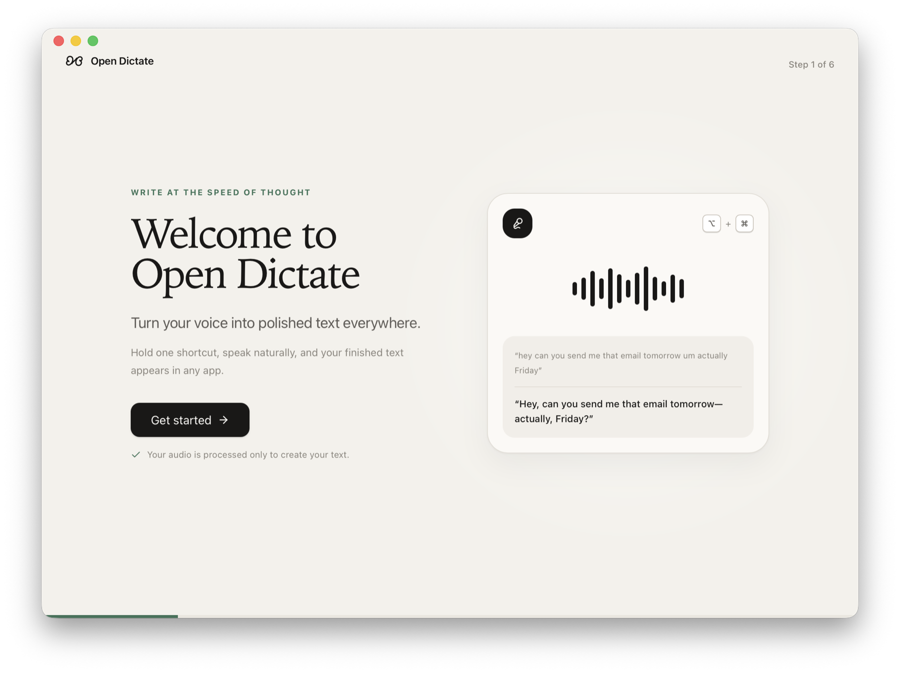
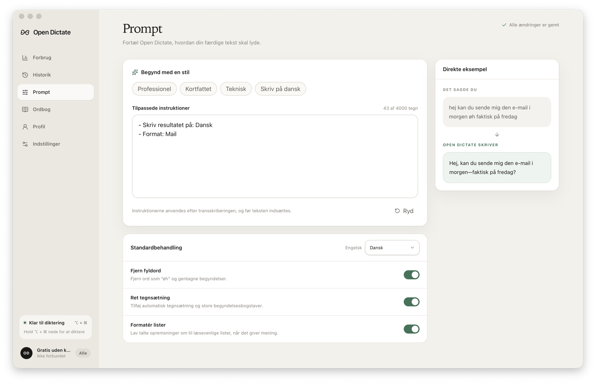
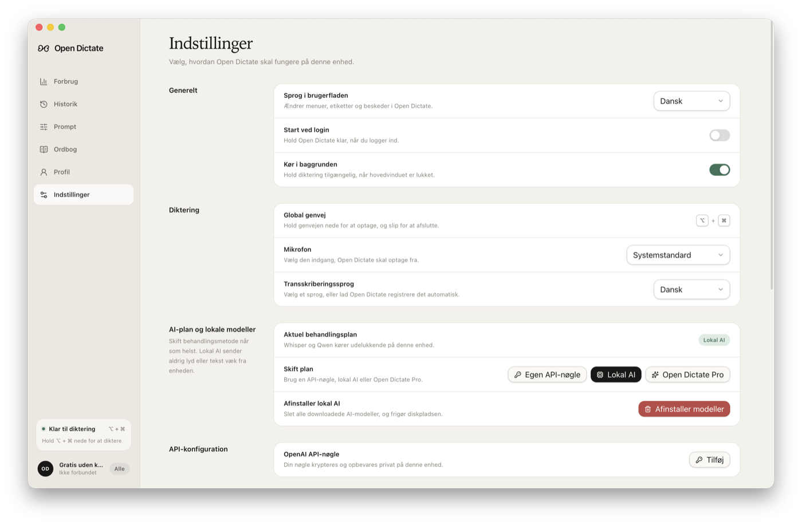

# Open Dictate

[](https://github.com/Goprogabriel/Open-Dictate/releases/download/app-v0.1.0/Open-Dictate_0.1.0_aarch64.dmg)
[](https://github.com/Goprogabriel/Open-Dictate/actions/workflows/ci.yml)
[](./LICENSE)

Open Dictate is an open-source voice-dictation app for macOS. Hold the global shortcut, speak, and the finished text is inserted into the app you were using.

**[Download Open Dictate 0.1.0 for Apple Silicon Mac](https://github.com/Goprogabriel/Open-Dictate/releases/download/app-v0.1.0/Open-Dictate_0.1.0_aarch64.dmg)**

> This is an early preview for macOS 12+. The app is ad-hoc signed but not Apple-notarized, so macOS may ask you to approve it under **System Settings → Privacy & Security**.



## What it does

- System-wide push-to-talk dictation.
- Offline Local AI with Whisper and Qwen.
- Optional bring-your-own OpenAI API key.
- Custom writing prompts, vocabulary, history, and four interface languages.
- Encrypted local storage for private settings and dictation data.

<p align="center">
  
  
</p>

## Run from source

Requires Node.js 22+, Rust 1.85+, and the macOS or Windows native build tools.

```bash
npm ci
npm run desktop:dev
```

See [SETUP.md](./SETUP.md) for full setup and [CONTRIBUTING.md](./CONTRIBUTING.md) to contribute. Security and privacy details are in [SECURITY.md](./SECURITY.md).

## License

[MIT](./LICENSE). Downloaded Local AI models retain their own licenses; see [THIRD_PARTY_NOTICES.md](./THIRD_PARTY_NOTICES.md).
