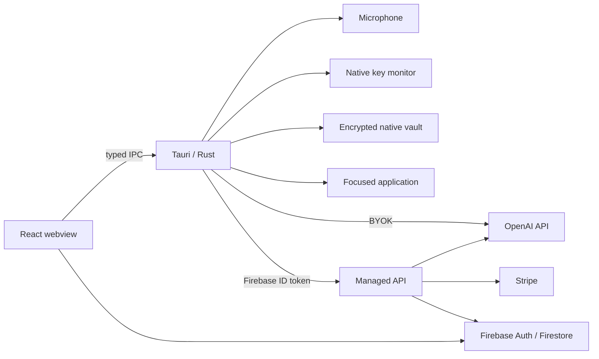

# Open Dictate

[](https://github.com/Goprogabriel/Open-Dictate/actions/workflows/ci.yml)
[](./LICENSE)
[](#supported-platforms)
[](#supported-platforms)

Open Dictate is a native desktop voice-dictation application for macOS and Windows. Hold a push-to-talk shortcut, speak naturally, and insert polished text into the application you were using.

The product is built with Tauri 2, Rust, React, TypeScript, Tailwind CSS, Zustand, Firebase, Stripe, and OpenAI.

> **Project status:** `0.1.0` is an early preview. Local AI, BYOK, the native dictation path, encrypted local state, and the optional managed backend are implemented. Community test builds are ad-hoc signed or unsigned; a trusted public release still requires clean-machine validation plus Apple notarization and Windows code signing.

## Try it on a Mac

Check [GitHub Releases](https://github.com/Goprogabriel/Open-Dictate/releases) for a macOS DMG. If
there is no release yet, build an Apple Silicon demo locally:

```bash
npm ci
npm run release:demo
```

The DMG is written to `release/artifacts/v0.1.0/macos-arm64/`. A public demo deliberately contains
no Firebase project, managed API, Stripe account, or maintainer credentials. It supports Local AI
and BYOK. Because the community DMG is only ad-hoc signed, macOS may ask you to approve it in
**System Settings → Privacy & Security**. Do not treat it as a notarized production release.

## Product modes

| Mode             | Identity            | OpenAI access                                                                                  | Billing                                                     |
| ---------------- | ------------------- | ---------------------------------------------------------------------------------------------- | ----------------------------------------------------------- |
| Free / BYOK      | No account required | The user's key is encrypted in private app storage and used by Rust for direct OpenAI requests | The user pays OpenAI directly                               |
| Local AI         | No account required | Whisper and Qwen run inside the native app; audio and text never leave the device              | Free after the selected models are downloaded               |
| Open Dictate Pro | Firebase account    | A managed backend calls OpenAI; no service API key ships in the application                    | Stripe subscription and server-owned token-allowance ledger |

“BYOK” does not mean offline processing: audio and transformation inputs are sent to OpenAI. It means Open Dictate does not provide or centrally bill the API credential. See [SECURITY.md](./SECURITY.md) for the full trust boundary.

Local AI downloads its selected Whisper and Qwen model pair once, verifies each file before activation, and then performs transcription and polishing entirely on-device without an account, API key, subscription, or network connection. The quality tier and processing mode can be changed later in Settings.

Self-hosters can optionally configure the managed mode with their own Firebase, Stripe, and OpenAI accounts. Prices, allowances, conversion rates, provider-cost schedules, and margins are deployment parameters rather than repository defaults. Subscription credits are period-bound; purchased credits are non-expiring and consumed only after subscription credits.

The authenticated API returns the two pools separately plus their combined `remainingTokens` total. The backend keeps the same integer accounting unit in fields and deployment parameters named `*Credits`; those internal credits are not raw OpenAI token counts. Provider transcription and transformation token counts are metering inputs to the configured conversion policy.

Both native BYOK and managed Functions default to `gpt-4o-mini-transcribe` for speech-to-text plus `gpt-5-mini` for polishing. Each path can still be configured independently.

## Intended experience

- System-wide hold-to-dictate with a small, non-focusable recording indicator.
- Punctuation, filler-word removal, useful formatting, output-language selection, custom instructions, and vocabulary replacement.
- Usage, history, prompt, dictionary, profile, and settings views.
- English, Danish, Norwegian, and Swedish UI and transcription preferences.
- Background operation and optional start at login.
- Firebase account sync and Stripe-managed Pro billing.
- Privacy controls for local history and cloud data.

Open Dictate does not need Screen Recording permission. It records microphone audio and inserts text; it does not inspect screen pixels.

## Implementation status

| Capability                                                           | Repository status                                                                                                                               |
| -------------------------------------------------------------------- | ----------------------------------------------------------------------------------------------------------------------------------------------- |
| App shell, sidebar, six product pages, onboarding, HUD               | Implemented                                                                                                                                     |
| Responsive premium UI and four locale files                          | Implemented                                                                                                                                     |
| Zustand stores and typed service contracts                           | Implemented                                                                                                                                     |
| Browser preview adapter                                              | Implemented for UI development; it is not system-wide dictation                                                                                 |
| Firebase email/password and account synchronization                  | Implemented; production Firebase project and service configuration remain                                                                       |
| Firebase settings/dictionary/history/usage repositories              | Implemented with timestamped prompt merging and durable dictionary tombstones for cross-device correctness                                      |
| Native audio recording                                               | Implemented; clean-machine macOS and Windows validation remains                                                                                 |
| Modifier-only global key monitor and focus-safe insertion            | Implemented; the platform input matrix remains a release gate                                                                                   |
| Encrypted local BYOK credential flow                                 | Implemented; private-file and clean-machine validation remain                                                                                   |
| Offline Local AI with resumable, verified model downloads            | Implemented with Whisper/llama.cpp, persisted quality tiers, and model removal on sign-out or uninstall                                         |
| Managed transcription, usage ledger, Stripe Checkout/Portal/webhooks | Implemented with UUID recovery, period-bound subscription tokens, and source-aware accounting; production configuration and external E2E remain |
| Additional-token purchases                                           | Implemented for allow-listed USD 5/10/20 Stripe prices with non-expiring, idempotent purchased-token grants                                     |
| Encrypted local history, prompt, and dictionary cache                | Implemented with AES-256-GCM, UID-separated scopes, a private local key, and safe legacy-state adoption                                         |
| History retention                                                    | Implemented for 7/30/90/365 days locally and with Firestore `expiresAt` plus scheduled backend cleanup                                          |
| Signed, notarized macOS and signed Windows installers                | Not configured                                                                                                                                  |

For the exact distinction between checked-in code and target behavior, read [ARCHITECTURE.md](./ARCHITECTURE.md).

## Supported platforms

- macOS 12 or later is the current bundle target.
- Windows 10 and Windows 11 are the intended supported Windows releases.
- Linux is not currently supported.

The modifier-only shortcut is Option + Command on macOS and Alt + Win on Windows. Both paths use a short arming delay and cancel when a third key is pressed so ordinary application shortcuts continue to work. User-configurable shortcut selection is a future extension rather than a current setting.

## Quick start

### 1. Install prerequisites

- Node.js 22 or later
- Rust 1.85 or later with the stable toolchain
- macOS: Xcode Command Line Tools
- Windows: Microsoft C++ Build Tools with **Desktop development with C++** and WebView2 Runtime

See [SETUP.md](./SETUP.md) for platform, Firebase, OpenAI, Stripe, signing, and release setup.

### 2. Install dependencies

```bash
npm ci
```

### 3. Run the web UI

```bash
npm run dev
```

The browser build is useful for interface work. It cannot register a true system-wide shortcut, use the native credential vault, or insert into other desktop applications.

To populate the UI with local preview data, create an ignored `.env.local` file:

```dotenv
VITE_ENABLE_PREVIEW_DATA=true
```

With preview data enabled, open `http://localhost:1420/?preview=onboarding` to exercise the onboarding flow without contacting Firebase, Stripe, or OpenAI.

### 4. Run the Tauri application

```bash
npm run desktop:dev
```

Native development requires the platform toolchain and permission setup described in [SETUP.md](./SETUP.md). A successful frontend preview does not prove that native recording, global monitoring, or insertion works.

## Optional client configuration

The Firebase and managed-API values consumed by Vite are public client configuration:

```dotenv
VITE_FIREBASE_API_KEY=
VITE_FIREBASE_AUTH_DOMAIN=
VITE_FIREBASE_PROJECT_ID=
VITE_FIREBASE_STORAGE_BUCKET=
VITE_FIREBASE_MESSAGING_SENDER_ID=
VITE_FIREBASE_APP_ID=
VITE_API_BASE_URL=
VITE_ENABLE_PREVIEW_DATA=false
VITE_ENABLE_FIREBASE_EMULATORS=false
```

Managed desktop builds also require a native compile-time origin pin. `npm run release:build`
derives it from `VITE_API_BASE_URL`; direct `tauri build` calls can set it explicitly. For a local
Cargo configuration, copy `.cargo/config.toml.example` to the ignored `.cargo/config.toml` and
replace the placeholder, or export it in the build shell:

```bash
export OPEN_DICTATE_MANAGED_API_ORIGIN="https://REGION-PROJECT_ID.cloudfunctions.net"
npm run desktop:build
```

Set the bare HTTPS origin—scheme, host, and optional port, without `/api`. It must match the origin of `VITE_API_BASE_URL`; changing it after the binary is built has no effect. Debug builds permit loopback HTTP for local emulators.

Do not place `OPENAI_API_KEY`, `STRIPE_SECRET_KEY`, `STRIPE_WEBHOOK_SECRET`, Firebase service-account JSON, signing certificates, or any other privileged value in a `VITE_*` variable. Vite values are bundled into client assets.

## Development commands

| Command                        | Purpose                                                             |
| ------------------------------ | ------------------------------------------------------------------- |
| `npm run dev`                  | Start the Vite browser development server                           |
| `npm run desktop:dev`          | Start the Tauri desktop application in development                  |
| `npm run build`                | Type-check and build the frontend                                   |
| `npm run release:demo`         | Build a distributable without managed-service configuration         |
| `npm run desktop:build`        | Build platform bundles; signing must be configured separately       |
| `npm run check`                | Run formatting, type, lint, test, locale, and frontend build checks |
| `npm run check:functions`      | Run managed-backend type, lint, unit-test, and build checks         |
| `npm run functions:test:rules` | Run Firestore Rules tests against the emulator                      |
| `npm run check:rust`           | Run Rust formatting, Clippy with warnings denied, and native tests  |

## Architecture at a glance



The native controller must arm the modifier-only shortcut before recording, cancel if a third key appears, capture the original focus target, and revalidate it before insertion. The managed API must verify identity, reserve allowance, settle actual usage, and handle Stripe events idempotently.

Audio processing measures both total recording time and voice-active time locally. Closing the main window either hides to the tray or exits according to the persisted **Run in background** preference; start-at-login uses the native autostart integration, launches hidden, and hydrates the UI from the actual OS registration at startup.

For each managed dictation, the desktop sends the current scoped custom prompt, output language, transformation toggles, and up to 100 vocabulary entries relevant to the selected language. The backend strictly validates that request snapshot before using it. Firestore settings and dictionary documents provide durable cross-device synchronization; they are not reloaded as the immediate source for an already submitted dictation.

Dictionary deletions are synchronized as terminal, timestamped tombstone documents. A tombstone always beats a live record with the same ID regardless of clock order, Firestore rejects tombstone-to-live updates, and intentionally re-adding a term creates a new UUID. Prompt resets use explicit `updatedAt` metadata rather than interpreting default values as a missing document.

The recording UUID is also the managed `Idempotency-Key`. On an ambiguous response, Rust checks `GET /v1/dictation-requests/:requestId` and makes only the bounded retry allowed by the existing-job result. The managed function permits 300 seconds, the native request permits 330 seconds, and provider calls are bounded separately. Recovery currently lives in the running process: a restart does not replay a persisted pending request, and startup cleanup removes any abandoned temporary recording.

## Firestore paths

The application uses exact top-level, UID-partitioned paths:

```text
users/{uid}
settings/{uid}
dictionary/{uid}/entries/{entryId}
dictations/{uid}/items/{dictationId}
usage/{uid}/periods/{yyyy-mm}
subscriptions/{uid}
subscriptions/{uid}/ledger/{entryId}
billing_events/{stripeEventId}      # server only
transcription_jobs/{requestId}      # server only
```

Do not move user data under `users/{uid}` subcollections without a coordinated schema migration across the desktop repositories, backend, rules, indexes, tests, and documentation.

## Documentation

- [ARCHITECTURE.md](./ARCHITECTURE.md) — boundaries, data flow, dictation safety, exact Firestore model, and expansion points
- [SETUP.md](./SETUP.md) — local development, Firebase/OpenAI/Stripe configuration, permissions, signing, and releases
- [SECURITY.md](./SECURITY.md) — threat model, secret handling, current security debt, and release gates
- [CONTRIBUTING.md](./CONTRIBUTING.md) — contribution workflow and engineering invariants
- [SUPPORT.md](./SUPPORT.md) — where to ask for help and what to include
- [THIRD_PARTY_NOTICES.md](./THIRD_PARTY_NOTICES.md) — Local AI model and dependency licensing
- [CODE_OF_CONDUCT.md](./CODE_OF_CONDUCT.md) — community expectations

## Before calling a build production-ready

A release must pass the security and release gates in [SECURITY.md](./SECURITY.md), including:

- native modifier arming and third-key cancellation tests;
- focus-token revalidation and fail-closed insertion;
- OS-vault BYOK tests with no secret-bearing logs;
- Firebase Rules emulator tests and server-owned usage/billing writes;
- Stripe subscription/top-up signature and idempotency tests against the configured external account, including period expiry, pool priority, and all three pack mappings;
- AES-256-GCM scoped-vault, cross-account isolation, and legacy-adoption validation in signed builds;
- managed UUID replay/status recovery, 300/330-second timeout, and retention-cleanup validation;
- a release build compiled with the production `OPEN_DICTATE_MANAGED_API_ORIGIN` pin;
- signed/notarized macOS and signed Windows installer smoke tests;
- permission onboarding and upgrade testing on clean machines.

Until those gates pass, use the project for development and evaluation only.

## License

Open Dictate is available under the [MIT License](./LICENSE). Downloaded Local AI models and all
third-party packages remain under their respective licenses; see [THIRD_PARTY_NOTICES.md](./THIRD_PARTY_NOTICES.md).
